### `$ whoami`

I build robots that work in the field, not just in simulation: localization, navigation, motion planning, and the embedded systems underneath them.

I spent four years at **KOU ROVER**. I started as a team member and ended up leading **35+ engineers** through the **European Rover Challenge**, with back-to-back **TEKNOFEST 1st places** along the way. Today I'm an R&D software engineer working on STM32-based industrial systems.

### `$ ros2 launch so101_follower bringup.launch.py`

I'm building an **SO-101 follower arm** from scratch and bringing it into ROS 2 through a C++ `ros2_control` interface. The goal is hybrid manipulation: MoveIt handles the easy part fast, a learned **VLA policy** handles the precise part, and a Behavior Tree decides who drives. Then I measure the difference.

→ [`so101-hybrid-manipulation`](https://github.com/enesbirlik/so101-hybrid-manipulation)

### `$ ros2 topic echo /projects`

- 🚙 **Autonomous rover**: Nav2 + SLAM with LiDAR, GPS, IMU, and ZED2 fusion
- 🦾 **6-DOF arm**: ROS2 + MoveIt2 + `ros2_control` for European Rover Challenge missions
- ✋ **Hand-tracking teleop**: a camera-tracked hand drives a MuJoCo arm
- 🎯 **Cart-pole**: PID vs LQR vs fuzzy control on real hardware, ROS2 ↔ MATLAB

Photos, videos, and the full stories are on the site 👇

  

### `$ cat /etc/stack.yaml`

  
  
  
  
  
  
  
  
  
  
  

### `$ ros2 topic echo /github`

  
  

  

### `$ ros2 service call /contact`

Let's build something that moves. I'm open to robotics software, autonomy, and embodied-AI roles.

  
  

